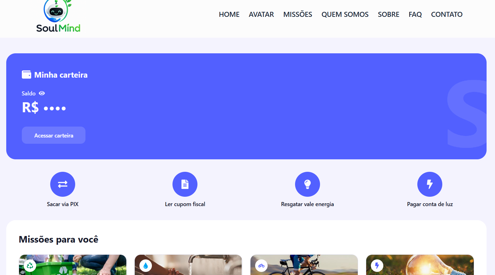

# SoulMind 🌱


## Descrição do Projeto

O **SoulMind** é o chatbot de uma solução desenvolvida para a **SoulUp**, com o objetivo de aumentar o engajamento das pessoas com a sustentabilidade através da gamificação.

A proposta é tornar pequenas ações ambientais mais acessíveis, motivadoras e recompensadoras. Para isso, o SoulMind permite que o usuário gerencie sua conta na plataforma, acumule pontos, acompanhe seu progresso e personalize seu avatar.

O projeto foi desenvolvido na **Sprint 4 de Front-End Design Engineering da FIAP**, dando continuidade às sprints anteriores. Nesta etapa, o front-end passou a **consumir a API REST em Java (DDD)** desenvolvida pelo grupo, publicada na nuvem.

---

## Como Usar

| Item | Link |
|---|---|
| Repositório no GitHub | <https://github.com/eneiqmaneiro/Challenge4-SoulMind.git> |
| Vídeo de apresentação (YouTube) | <COLE_AQUI_O_LINK_DO_VIDEO_NO_YOUTUBE> |
| Aplicação publicada (Vercel) | <COLE_AQUI_A_URL_DA_VERCEL> |
| API publicada (Java) | https://challenge4-avatarsoulup.onrender.com |

### Executar localmente

Pré-requisito: **Node.js** instalado.

```bash
# 1. Clone o repositório
git clone https://github.com/eneiqmaneiro/Challenge4-SoulMind.git

# 2. Acesse a pasta do projeto
cd SoulMind

# 3. Instale as dependências
npm install

# 4. Configure a URL da API
cp .env.example .env   # edite o .env e informe VITE_API_URL

# 5. Execute o projeto
npm run dev
```

A aplicação ficará disponível em `http://localhost:5173`.

### Variável de ambiente

| Variável | Descrição |
|---|---|
| `VITE_API_URL` | URL base da API Java publicada, sem barra no final. Na Vercel, cadastre em *Settings → Environment Variables*. |

### Endpoints consumidos

| Método | Endpoint | Uso na aplicação |
|---|---|---|
| GET | `/contas` | Listagem de contas (Home e página Contas) |
| GET | `/contas/{codigo}` | Detalhes da conta (rota dinâmica `/contas/:id`) |
| POST | `/contas` | Cadastro de nova conta |
| PUT | `/contas/{codigo}` | Edição de conta |
| DELETE | `/contas/{codigo}` | Exclusão de conta |

Corpo de `POST`/`PUT`: `{ "nome", "apelido", "email", "senha" }` (nome 3–100, apelido 2–20, senha 12–30 caracteres).
A resposta (`codigo`, `nome`, `apelido`, `email`) não inclui a senha. Na edição, a senha precisa ser informada novamente.

---

## Tecnologias Utilizadas

- React 19 + TypeScript
- Vite
- Tailwind CSS 4
- React Router
- React Hook Form
- React Icons
- Fetch API nativa (consumo da API REST em Java)
- Vercel (deploy do front-end)
- Figma, Git, GitHub e Visual Studio Code

---

## Estrutura de Pastas

```text
SoulMind/
├── public/
├── src/
│   ├── assets/            # imagens e ícones do projeto
│   ├── components/        # Header, Footer, Bot, MensagemEstado, FormularioConta
│   ├── data/              # dados estáticos (avatares e integrantes)
│   ├── hooks/             # useContas, useConta
│   ├── pages/             # Home, Contas, DetalhesConta, Avatar, Tour,
│   │                      # Sobre, QuemSomos, Faq, Contato, Error
│   ├── services/          # api.ts, contaService.ts
│   ├── utils/             # funções auxiliares (iniciais)
│   ├── types/             # interfaces e tipos TypeScript
│   ├── App.tsx
│   ├── globals.css
│   └── main.tsx           # rotas (React Router)
├── .env.example
├── index.html
├── package.json
├── tsconfig*.json
├── vercel.json            # rewrite para SPA na Vercel
└── vite.config.ts
```

---

## Imagens e Ícones




Os ícones da interface vêm da biblioteca **React Icons**.

---

## Autores e Créditos

### Ludmylla Nogueira


- **RM:** 572999
- **Turma:** 1TDSPW
- **LinkedIn:** https://www.linkedin.com/in/ludmylla-nogueira-11991927a
- **GitHub:** https://github.com/Ludmylla1905

### Henrique Tavares Coutinho


- **RM:** 569336
- **Turma:** 1TDSPW
- **LinkedIn:** https://www.linkedin.com/in/henrique-tavares-coutinho-81a512356
- **GitHub:** https://github.com/eneiqmaneiro

### Pedro Nunes Ferreira


- **RM:** 573066
- **Turma:** 1TDSPW
- **LinkedIn:** https://www.linkedin.com/in/pedro-nunes-1089133b4
- **GitHub:** https://github.com/Pedronuf

---

## Contato

Caso tenha dúvidas, sugestões ou queira entrar em contato com a equipe:

Email: ludmilanogueira231@gmail.com, henriquetacou@gmail.com, pp23104554@gmail.com
